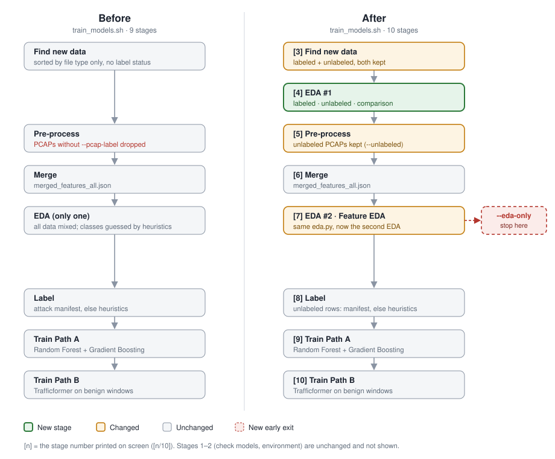

# Adding EDA to the training flow

**Week 2 · DNS Traffic Anomaly Detection · `scripts/train_models.sh`**

## Summary

- The training script now runs an **exploratory data analysis (EDA) right after it finds new data**, before any pre-processing. A second EDA still runs after the data is merged.
- **"Find new data" now keeps both labeled and unlabeled data** and reports which is which. Unlabeled PCAP captures used to be dropped; they are now kept.
- The new EDA analyses the **labeled data**, the **unlabeled data**, and **how the two compare**, then states what the findings mean for feature engineering and model choice. It writes a JSON report and an HTML report with charts.
- On the current dataset, it shows that the labeled data is **too easy** (one measure, entropy, separates attack from benign with AUC 0.996) and that attack and benign traffic were **captured 683 days apart**. Both inflate the model's reported accuracy.
- A new `--eda-only` option stops after both EDA reports, so the data can be reviewed before any model is trained.

## 1. Why add EDA here

EDA is the step that investigates, summarizes and visualizes a dataset before it reaches a model. It serves six purposes:

1. **Data quality**: missing values, duplicates, wrong types, corrupted or empty input
2. **Outliers and anomalies**: extreme values that are either errors or real signals
3. **Distributions and relationships**: how each measure is distributed, and how measures relate to each other and to the label
4. **Feature engineering**: which features to add, transform or drop
5. **Algorithm choice**: data size, shape and balance, which decide what kind of model fits
6. **Garbage in, garbage out**: hidden bias, class imbalance and structural flaws that make a model look better than it is

The usual order is univariate analysis, then bivariate, then outliers, plus a class-balance check for classification ([CMU, EDA chapter](https://www.stat.cmu.edu/~hseltman/309/Book/chapter4.pdf)). Validating data before it is processed, by comparing statistics against expectations and listing anomalies, is the approach of [TensorFlow Data Validation](https://www.tensorflow.org/tfx/guide/tfdv).

**Before this change**, the pipeline had one EDA, run after merging. It mixed all sources together and guessed attack and benign classes from the heuristic `attack_count`. Nothing looked at the input files on their own, and files without a label had no visible place in the flow.

## 2. The new training flow



| # | Stage (line printed on screen) | Status |
|---|---|---|
| 1 | Check existing models | unchanged |
| 2 | Environment | unchanged |
| 3 | **Find new data: labeled + unlabeled** | changed |
| 4 | **EDA #1: labeled · unlabeled · comparison** | **new** |
| 5 | Pre-process (logs, PCAPs; unlabeled PCAPs kept) | changed |
| 6 | Merge | unchanged |
| 7 | EDA #2: feature EDA (existing `eda.py`) | renamed |
| — | `--eda-only` stops here | **new** |
| 8 | Label (manifest, else heuristics) | unchanged |
| 9 | Train Path A | unchanged |
| 10 | Train Path B | unchanged |

An interactive version of the full flow is in [`training_flow.html`](training_flow.html). Open it in a browser and click any box to see what that stage reads and writes, and its known issues.

## 3. Find new data: labeled and unlabeled

Every discovered file now gets a label status, and both kinds go forward.

| File type | Labeled when … | Otherwise |
|---|---|---|
| `.json` / `.csv` | the rows have `label` 0 or 1 (a file with only some labeled rows is split row by row) | unlabeled |
| `.pcap` / `.pcapng` | `--pcap-label 0\|1` is given | unlabeled, **now kept** (previously skipped) |
| `.log` (Technitium) | never | unlabeled |

The stage prints the split and says how the unlabeled part will get its labels later:

```
[3/10] Found 5 new file(s): 2 labeled (2 json), 3 unlabeled (3 log)
      ! No attack manifest — unlabeled data will get heuristic labels (circular)
```

Unlabeled data is labeled at stage 8: from `data/attack_manifest.csv` when it exists (independent labels, by time window and source IP), otherwise from the heuristic `attack_count`. Rows that already carry a label keep it.

## 4. EDA #1 design

Every file, whatever its format, is read into **one table with one row per DNS query** and the same measures: query length, longest label, subdomain count, character entropy and digit ratio. They are computed with the project's own feature functions, so labeled and unlabeled data are measured identically.

| Section | What it checks | EDA purpose |
|---|---|---|
| **A · Labeled data** | rows per file, duplicates, missing fields | 1 |
| | attack vs benign counts per file and per attack family; warns if one class is under 10 % | 6 |
| | each measure per class (median, p95, histograms); query types and response codes | 3 |
| | how well each measure *alone* separates the classes (ROC AUC); warns above 0.95 | 3, 4 |
| | outliers by the IQR rule (1.5× and 3×); labels longer than 52 characters | 2 |
| | attack and benign captured more than a day apart | 6 |
| **B · Unlabeled data** | lines vs parsed queries, empty files, duplicates, missing fields | 1 |
| | query types, response codes, clients, parent domains, queries per minute | 3 |
| | NXDOMAIN rate per client, length per query type, unique subdomains per parent domain | 3 |
| | IQR outliers; one client sending ≥ 95 % of a file's queries; NXDOMAIN rate above 20 % | 2 |
| | how it will be labeled and what share of the training data it will be | 6 |
| **C · Comparison** | shift between labeled and unlabeled per measure (PSI and KS); warns when PSI > 0.25 | 3, 6 |
| | for each unlabeled file: closer to the attack profile, the benign profile, or neither | 6 |
| **D · Implications** | rule-based notes on what the findings mean for features and model choice | 4, 5 |

The DNS thresholds are heuristics taken from detection guides and are used only to raise warnings: NXDOMAIN above 20 % is high ([Wireshark DNS analysis tool](https://glama.ai/mcp/servers/@Presidio-Federal/wireshark-mcp-container/blob/487025dee33e234bb376c0f97ffb5dcad375ce1c/tools/dns_analysis_tool.py)); labels over 52 characters are a strong tunneling sign ([DNS exfiltration analysis](https://skills.cat/skills/mukul975/anthropic-cybersecurity-skills/analyzing-dns-logs-for-exfiltration)); TXT, NULL and CNAME are favoured by tunnels ([OPSWAT](https://www.opswat.com/docs/mdndr/operating-guide/tunneling-investigation)); over 50 unique subdomains under one parent domain is suspicious ([Zeek tunneling hunt](https://www.claudemarket.ai/skills/mukul975/hunting-for-dns-tunneling-with-zeek)).

**EDA never stops training.** It only warns. To review the data first, use `--eda-only`.

**Outputs** (in `data/processed/`):
- `eda_data_report.json`: every number plus the list of warnings
- `eda_data_report.html`: an offline page with sections A–D and charts (class balance, per-class histograms with the IQR fence, query types, response codes, NXDOMAIN per client, queries-per-minute timelines, labeled-vs-unlabeled overlays)

A report generated from the current data is in [`sample_report/eda_data_report.html`](sample_report/eda_data_report.html).

## 5. How to run it

```bash
# Review the data only: both EDA reports, then stop.
# Nothing is labeled, trained, or marked as trained.
./scripts/train_models.sh --eda-only --files data/processed/labeled_tunnels.json \
    data/processed/labeled_benign.json data/raw/2026-03-18.log

# Normal training (EDA #1 and #2 run automatically and only warn)
./scripts/train_models.sh --files ...

# EDA #1 on its own
python -m dns_detect.features.eda_data \
    --labeled data/processed/labeled_tunnels.json data/processed/labeled_benign.json \
    --unlabeled data/raw/2026-03-18.log \
    --output data/processed/eda_data_report.json

# Label status only, one line per file
python -m dns_detect.features.eda_data --status data/raw/*.log data/processed/*.json
```

## 6. Results on the current dataset

Input: 2 labeled files and 3 unlabeled Technitium logs.

| | Value |
|---|---|
| Labeled rows | 18,353: 10,000 attack (dns2tcp 8,000, dnsexfiltrator 2,000) / 8,353 benign |
| Unlabeled rows | 8,152, all from `2026-03-18.log`; `2026-03-19.log` and `2026-03-20.log` contain 0 queries |
| Attack capture dates | 2019-04-24 → 2024-12-10 |
| Benign capture dates | 2026-10-23 → 2026-10-24 (683 days after the last attack capture) |

**Separability of the labeled data: each measure on its own (ROC AUC)**

| Measure | Attack median | Benign median | AUC |
|---|---|---|---|
| entropy | 4.29 | 3.24 | **0.996** |
| query_length | 26 | 13 | **0.984** |
| digit_ratio | 0.125 | 0.000 | 0.950 |
| longest_label | 11 | 8 | 0.914 |
| subdomain_count | 2 | 1 | 0.866 |

**The unlabeled log** (`2026-03-18.log`): 8,152 queries from a single client (192.168.197.135) within 3 minutes, NXDOMAIN rate 99.95 %, 8,148 unique subdomains under `lab.local`, 99.98 % A queries. This is a subdomain-enumeration or NXDOMAIN-flood pattern.

**Labeled vs unlabeled shift:** PSI is above 0.25 on all five measures (from 0.94 for digit ratio to 5.21 for subdomain count). By name shape alone, the unlabeled log is closer to the *benign* profile (distance 0.45 vs 0.99 to attack), even though its behaviour is clearly abnormal.

**Warnings raised (9):**
1. Entropy alone separates attack from benign (AUC 0.996): the labeled data may be too easy.
2. Query length alone separates them (AUC 0.984).
3. Attack and benign data were captured 683 days apart: the model could learn *when*, not *what*.
4. `2026-03-18.log`: one client sends 100 % of the queries.
5. `2026-03-18.log`: NXDOMAIN rate 99.95 %.
6. `2026-03-19.log` has 0 DNS queries.
7. `2026-03-20.log` has 0 DNS queries.
8. 8,148 unique subdomains under `lab.local`.
9. Unlabeled data differs strongly from labeled data on all five measures.

## 7. What this means for the model

- **The current high scores mostly reflect one measure.** Entropy alone nearly separates the classes. Before trusting accuracy, add harder data: benign traffic with long or random-looking names (CDNs, cloud services) and tunnels that use short names.
- **Time is a hidden label.** Attack and benign traffic come from different years. Time fields must stay out of the features, and evaluation should use attack and benign traffic captured in the same period.
- **`answer_count` is not usable yet.** The labeled data comes from PCAPs with queries only (no responses), while Technitium logs record answers. A feature that depends on the source rather than the traffic teaches the model the wrong thing.
- **Behaviour matters more than name shape.** The NXDOMAIN flood in `2026-03-18.log` looks benign query by query. Per-client features (NXDOMAIN share, query rate, unique subdomains per parent domain) would capture it; per-query features cannot.
- **Tree models suit this data.** The length and count measures are strongly right-skewed. Random Forest and Gradient Boosting handle that without scaling; linear or distance-based models would need log scaling.
- **Class balance is fine** (1.2 : 1). Report PR-AUC alongside F1.
- **Unlabeled data needs independent labels.** Without `data/attack_manifest.csv`, the 31 % of rows that are unlabeled get heuristic labels computed from the same features the model learns, which is circular. Recording an attack manifest for lab captures fixes this.

## 8. Testing

- **Unit tests:** 16 pass (`tests/test_eda_data.py` and `tests/test_smoke.py`). They cover label status for every file type, class balance, the AUC warning, date-gap detection, empty files, the one-client and NXDOMAIN warnings, long labels, PSI on identical vs shifted data, nearest-profile results, both report files, the `--status` output, PCAPs with and without a label, and `make_labeled_features.py --unlabeled`.
- **End-to-end:** ran on a copy of the project with the real data. `--eda-only` stopped after both EDAs and left the trained-files registry empty. A normal run continued through labeling, where file labels were kept and unlabeled rows were labeled by heuristics.
- **Not yet run:** a full training run through Path A and Path B. TensorFlow was not available on the test machine; this needs one run on the Kali machine.
- **Bug found and fixed during testing:** unlabeled files were dropped from the stage-3 label split because an empty field in the status output merged with the next tab. Fixed, with a test added.

## 9. Files

| File | Change |
|---|---|
| `src/dns_detect/features/eda_data.py` | **new**: EDA #1 (readers, sections A–D, JSON and HTML reports, `--status`) |
| `tests/test_eda_data.py` | **new**: 11 tests |
| `scripts/train_models.sh` | label status in "Find new data", EDA #1 stage, unlabeled PCAPs kept, `--eda-only`, 10 stages |
| `scripts/make_labeled_features.py` | new `--unlabeled` mode (features without a label) |

The new code reuses existing parts of the project: the Technitium log parser and feature functions in `features/extractor.py`, the PCAP reading approach of `make_labeled_features.py`, and the PSI function in `monitoring/monitor.py`.

## 10. Limitations and next steps

- **Thresholds are heuristics** from detection guides, not values tuned on this dataset. They trigger warnings only.
- **"Looks like attack / benign / neither"** uses a simple distance between average standardized measures. It is a quick indicator, not a classifier.
- **Measures are per query.** Behavioural signals per client appear in section B, but they are not model features yet.
- **Next step: upgrade EDA #2** (`features/eda.py`) with a feature correlation heatmap, attack vs benign per model feature, and a per-source breakdown (Merge would need to tag each row with its source file).
- **Unchanged known issues** in training: `--retrain` trains only on the new files, and files are marked as trained before training succeeds.

## References

- Seltman, H. *Experimental Design and Analysis*, ch. 4 "Exploratory Data Analysis", Carnegie Mellon University: https://www.stat.cmu.edu/~hseltman/309/Book/chapter4.pdf
- TensorFlow Data Validation guide: https://www.tensorflow.org/tfx/guide/tfdv
- KDnuggets, "Data Validation in Machine Learning is Imperative, Not Optional": https://www.kdnuggets.com/2021/05/data-validation-machine-learning-imperative.html
- Wireshark DNS analysis tool (NXDOMAIN thresholds): https://glama.ai/mcp/servers/@Presidio-Federal/wireshark-mcp-container/blob/487025dee33e234bb376c0f97ffb5dcad375ce1c/tools/dns_analysis_tool.py
- Analyzing DNS logs for exfiltration (label length, baselining): https://skills.cat/skills/mukul975/anthropic-cybersecurity-skills/analyzing-dns-logs-for-exfiltration
- OPSWAT, Tunneling investigation (query types): https://www.opswat.com/docs/mdndr/operating-guide/tunneling-investigation
- Hunting for DNS tunneling with Zeek (subdomains per domain): https://www.claudemarket.ai/skills/mukul975/hunting-for-dns-tunneling-with-zeek
- Decryption Digest, How to detect DNS tunneling: https://www.decryptiondigest.com/blog/how-to-detect-dns-tunneling-in-network-traffic
