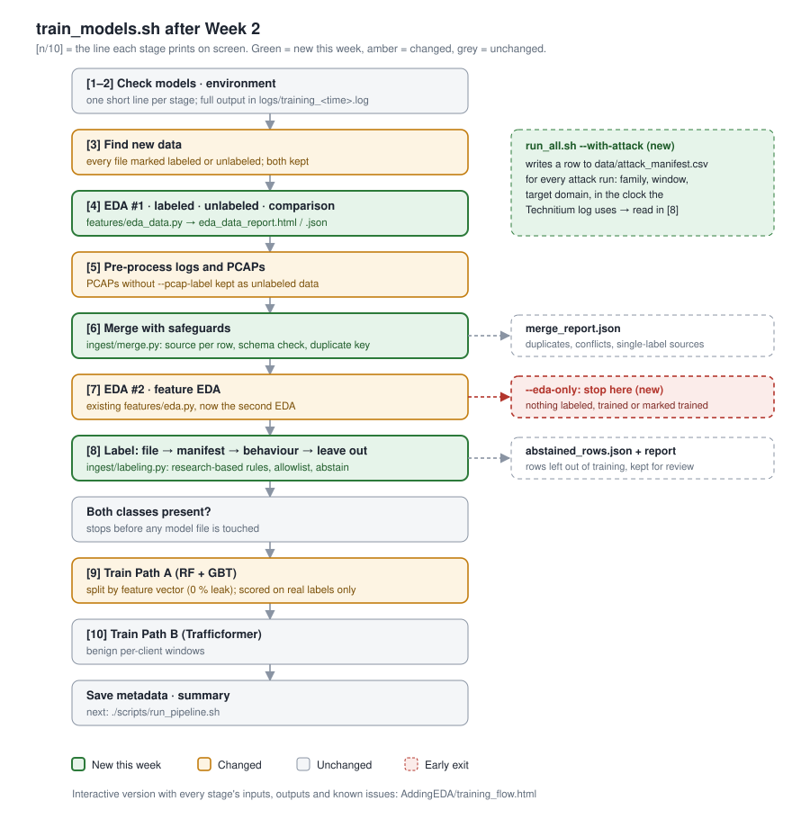

# Week 2 progress

**DNS Traffic Anomaly Detection · training pipeline (`scripts/train_models.sh`)**

## Summary

This week focused on making the training data trustworthy before improving the models.

- **The training script was rebuilt** to print one short line per stage, with the full output in a log file. It shrank from 1,078 to 749 lines.
- **"Find new data" now keeps labeled and unlabeled data** and reports which is which. Unlabeled PCAP captures used to be dropped.
- **Two EDA stages now run**: EDA #1 right after the data is found (labeled data, unlabeled data, and how they compare) and EDA #2 after merging. `--eda-only` stops after both.
- **Merge became a tested module** that records every row's original source, checks the schema, and reports duplicates and label problems.
- **Path A's train/test split no longer leaks.** Before, 79.8 % of test rows had an identical copy in the training set; now 0 %.
- **Labeling (Step 8) was rebuilt from DNS-tunneling research.** On the existing labeled data it makes 0 wrong labels, against 1,094 for the old rule, and catches 100 % of DNSExfiltrator queries instead of 71.7 %.
- **The main finding:** the current labeled data is too easy, so the models' near-perfect scores say little about real traffic. Once the lab's NXDOMAIN-attack log is added, the score drops to F1 0.985, the first non-perfect result, and it shows exactly what the model cannot yet see.



## 1. Training script: quieter and simpler

The script used to stream hundreds of lines of Python and TensorFlow output, boxed banners and repeated paths. Now each stage prints one numbered line, warnings appear as short `!` notes under it, and everything else goes to `logs/training_<time>.log`. `--verbose` shows the full output again.

```
[3/10] Found 3 new file(s): 2 labeled (2 json), 1 unlabeled (1 log)
[4/10] EDA: labeled 18353 (10000 attack / 8353 benign), unlabeled 8152 · 7 warning(s) → data/processed/eda_data_report.html
[6/10] Merged 26505 records from 3 file(s) · 8872 distinct feature vectors, 75% of rows duplicated · 0 label conflicts
[8/10] Labeled 18152 attack / 8353 benign · files 18353, behaviour 8152 (families: dns2tcp,dnsexfiltrator,nxdomain_enum)
```

Removed: decorative banners, about 60 informational lines, an unused `tshark` check (PCAPs are read with scapy), helpers that re-hashed files only for display, the `--rf-weight` / `--tf-weight` options (ignored by `path_a.py`), and 125 lines that rewrote the unchanged `pipeline_awareness_check.sh` on every run.

On failure, the script prints the last lines of the failing step's output and the log path.

## 2. Labeled and unlabeled data

| File type | Labeled when … | Otherwise |
|---|---|---|
| `.json` / `.csv` | rows carry `label` 0 or 1 (a partly labeled file is split row by row) | unlabeled |
| `.pcap` / `.pcapng` | `--pcap-label 0\|1` is given | unlabeled, **now kept** (`make_labeled_features.py --unlabeled`) |
| `.log` (Technitium) | never | unlabeled |

## 3. EDA before and after processing

Full write-up: [AddingEDA/REPORT.md](AddingEDA/REPORT.md).

- **EDA #1** (`src/dns_detect/features/eda_data.py`) runs right after the data is found. It reads every file type into one table and covers four sections: A, labeled data (class balance, attack vs benign per measure, single-measure AUC, capture dates); B, unlabeled data (empty files, clients, NXDOMAIN rate, outliers); C, labeled vs unlabeled shift; D, implications. It writes a JSON report and an offline HTML report with charts.
- **EDA #2** is the existing feature EDA, run after merging.
- Neither EDA stops training. `--eda-only` stops after both and marks nothing as trained.

## 4. Merge: best practice for combining sources

Merging all sources into one training table is standard, provided every row stays traceable, sources are checked against one schema, and duplicates are handled before splitting. The old merge was plain concatenation inside the bash script. The new `src/dns_detect/ingest/merge.py`:

- **Provenance:** gives every row `source_file` (the original log or capture, not the intermediate JSON), `source_type`, `label_source`, and `dup_key` (a hash of the 8 features the model sees).
- **Report:** writes `merge_report.json`, covering distinct feature vectors, duplicated rows, vectors seen with both labels, sources that hold only one class, and features that are missing or constant in one source type.
- **Bug fix:** the trained-files registry now stores full SHA-256 checksums. The old merge stored shortened ones, so `--retrain` never recognised JSON/CSV files it had already trained on.

## 5. Leak-free split in Path A

The merged labeled data has 18,353 rows but only 4,778 distinct feature vectors; 81 % of rows repeat another row exactly. With the old random split, **79.8 % of test rows had an identical copy in the training set**.

Path A now splits by feature vector (`StratifiedGroupKFold` on `dup_key`, in `src/dns_detect/models/splits.py`). Identical vectors never land on both sides, and vectors seen with both labels are dropped first. Overlap is now **0.0 %**.

| Split | Test rows with a copy in training | RF + GBT F1 / PR-AUC |
|---|---|---|
| Random rows (old) | 79.8 % | 1.0000 / 1.0000 |
| By feature vector (new) | 0.0 % | 1.0000 / 1.0000 |

The score did not drop, so duplicates were not what made it perfect. The labeled data itself is too easy (see section 8).

## 6. Labeling (Step 8), rebuilt from research

**Research basis.** DNS tunneling can be detected from single queries (long encoded names, rare record types) or from **traffic per domain** (many unique subdomains, each queried once, carrying a lot of information). The traffic view generalises across tools ([Farnham, SANS](https://www.sans.org/white-papers/34152); [Nadler et al. 2019](https://arxiv.org/pdf/1709.08395); [Ozery et al., NDSS 2024](https://www.ndss-symposium.org/wp-content/uploads/2024-388-paper.pdf)). Single indicators produce false alarms on CDNs, antivirus reputation lookups and DNS blocklists, so several must agree and known look-alikes need an allowlist ([Elastic](https://www.elastic.co/blog/plight-end-tunnel)). Labeling rules may vote or abstain instead of forcing a class ([Snorkel](https://www.vldb.org/pvldb/vol11/p269-ratner.pdf)). Matching one tool's signature is not enough on its own, so the extractor's check for the lab tool's own domain names (`.base32.`, `.base64.`) was removed.

**How a row gets its label** (`src/dns_detect/ingest/labeling.py`), first match wins:
1. **File label:** a label already in the data is kept.
2. **Attack manifest:** the query falls inside a recorded attack window (± 2 s for clock drift), comes from `source_ip` if given, and is under `target_domain` if given. Other traffic from the attacker's machine in that window is left out.
3. **Behaviour rules** per parent domain: many unique subdomains each queried once, high information volume, long encoded labels, tunnel record types (TXT/NULL/KEY/…), and NXDOMAIN enumeration per client. A row is labeled attack only when ≥ 2 rules agree (or NXDOMAIN enumeration fires), and benign for allowlisted or ordinary domains. Thresholds live in `config/settings.yaml` (`labeling:`) and the allowlist in `config/dns_allowlist.txt`.
4. **Left out:** anything else is excluded from training and saved to `abstained_rows.json`.

**Validation** (the labels on the existing labeled data were hidden and the rules run blind):

| | Old `attack_count` rule | New labeling |
|---|---|---|
| Wrong labels (18,353 rows) | 1,094 | **0** |
| DNSExfiltrator caught | 71.7 % | **100 %** |
| dns2tcp caught | 100 % | 100 % |
| Benign rows left out as uncertain | — | 79 |
| `2026-03-18.log` (NXDOMAIN attack) labeled attack | 1,865 of 8,152 | **8,152 of 8,152** (`nxdomain_enum`) |

**Automatic ground truth for lab attacks.** `run_all.sh --with-attack` now appends a manifest row for every attack run: family (from the attack flags), time window, and target domain. It records the window in whichever clock the Technitium log uses, UTC or host local time. This matters because the Technitium container has no timezone set, and the lab host is UTC+7. `source_ip` is left empty because, behind Docker, Technitium may see the bridge gateway instead of the attacker.

**Path A uses real labels to grade itself.** It trains on all labeled rows, but reports a separate score on rows with real labels only (file or manifest) under `test_trusted_labels` in `evaluation_metrics.json`. Behaviour labels never grade the model.

## 7. Key findings about the data

| Finding | Evidence | Why it matters |
|---|---|---|
| Labeled data is too easy | entropy alone separates attack from benign with AUC 0.996; query length 0.984 | high scores mostly reflect one measure |
| Attack and benign captured far apart in time | attack 2019-04-24 → 2024-12-10, benign 2026-10-23 → 24 (683 days) | the model could learn *when*, not *what* |
| Each source file holds one class | 5 attack PCAPs, 1 benign PCAP | capture differences can become a shortcut |
| `answer_count` carries no information | 0 in every PCAP row, real in log rows | a source artifact, not a traffic signal |
| Heavy duplication | 4,778 distinct vectors in 18,353 rows | random splits leak; fixed in section 5 |
| Lab NXDOMAIN attack | `2026-03-18.log`: 8,152 queries, one client, 3 minutes, 99.95 % NXDOMAIN | invisible per query (see below) |
| Two logs are empty | `2026-03-19.log`, `2026-03-20.log`: server status lines only | add nothing to training |

**First non-perfect score.** With the NXDOMAIN log included, 35 feature vectors (945 rows) appear with both labels. Short wordlist names like `apa-www.lab.local` look exactly like normal short names to Path A's per-query features. On test rows with real labels, the RF/GBT models reach **F1 0.985, precision 0.971, recall 1.0, PR-AUC 0.9999**. The NXDOMAIN attack is only visible as behaviour (one client, thousands of failed lookups). This run replaced the Transformer baseline with a stand-in; the decision models are real.

## 8. Testing

- **35 unit tests pass** (`pytest tests/`): EDA #1 (11), merge and split (9), labeling (10), smoke (5).
- **End-to-end runs** were done on a copy of the project with the real data: `--eda-only` stops after both EDAs and leaves the registry empty; a normal run goes through labeling with the expected screen lines; Path A splits with 0.0 % overlap.
- **Not yet done:** a full training run through Path A's Transformer baseline and Path B. TensorFlow is not installed on the development PC; this needs one run on the Kali machine.

## 9. Files

| File | Change |
|---|---|
| `scripts/train_models.sh` | rewritten: quiet output, 10 stages, label status, EDA #1, merge and labeling modules, `--eda-only` |
| `src/dns_detect/features/eda_data.py` | **new**: EDA #1 |
| `src/dns_detect/ingest/merge.py` | **new**: merge with provenance, schema and duplicate checks |
| `src/dns_detect/ingest/labeling.py` | **new**: Step 8 labeling (manifest, behaviour rules, abstain, validation mode) |
| `src/dns_detect/models/splits.py` | **new**: grouped, stratified split |
| `src/dns_detect/models/path_a.py` | grouped split, unlabeled rows dropped, trusted-label metrics |
| `src/dns_detect/parsing/dns_parser.py` | shared `feature_vector_key` and feature-frame helpers |
| `src/dns_detect/features/extractor.py` | removed the lab tool's domain-name shortcut |
| `scripts/make_labeled_features.py` | `--unlabeled` mode |
| `scripts/label_from_manifest.py` | thin wrapper over the new labeling module (same command) |
| `scripts/run_all.sh` | writes manifest rows for attack runs |
| `config/settings.yaml`, `config/dns_allowlist.txt` | labeling thresholds; benign allowlist |
| `data/attack_manifest.example.csv` | `target_domain` column |
| `tests/test_eda_data.py`, `tests/test_merge.py`, `tests/test_labeling.py` | **new** tests |
| `docs/Week2/` | this report, flow diagrams, EDA report and sample EDA output |

## 10. Next steps

In order of impact:

1. **Run the full training once on the Kali machine** (with TensorFlow) and record Path A and Path B metrics, including the trusted-label score.
2. **Collect harder data in the same period:** benign traffic with long or random-looking names (CDNs, cloud, update services) and tunnels using short names, captured alongside the attacks, with a manifest recorded by `run_all.sh --with-attack`.
3. **Add per-client behaviour features to the models** (NXDOMAIN share, query rate, unique subdomains per parent domain). The NXDOMAIN attack shows per-query features cannot see this kind of attack.
4. **Test on unseen attack tools** with `scripts/verify_models.py` (leave one family out).
5. **Upgrade EDA #2** with a feature correlation heatmap and a per-source breakdown (now possible, since Merge tags every row with its source).
6. **Known issues not yet fixed:**
   - `--retrain` trains new models on the new files only, forgetting earlier data.
   - Files are marked as trained before training succeeds.
   - Path A still chooses between RF-only and RF+GBT on the test set rather than the validation set.
   - Path B's residual connections may let it copy its input.

## References

- Farnham, G. *Detecting DNS Tunneling*, SANS Institute, 2013: https://www.sans.org/white-papers/34152
- Nadler, A., Aminov, A., Shabtai, A. *Detection of Malicious and Low Throughput Data Exfiltration Over the DNS Protocol*, Computers & Security, 2019: https://arxiv.org/pdf/1709.08395
- Ozery, Y., Nadler, A., Shabtai, A. *Information-Based Heavy Hitters for Real-Time DNS Data Exfiltration Detection*, NDSS 2024: https://www.ndss-symposium.org/wp-content/uploads/2024-388-paper.pdf
- Elastic, *Plight at the end of the tunnel*: https://www.elastic.co/blog/plight-end-tunnel
- Ratner, A. et al. *Snorkel: Rapid Training Data Creation with Weak Supervision*, VLDB 2018: https://www.vldb.org/pvldb/vol11/p269-ratner.pdf
- Arp, D. et al. *Dos and Don'ts of Machine Learning in Computer Security*: https://arxiv.org/pdf/2010.09470
- TensorFlow Data Validation guide: https://www.tensorflow.org/tfx/guide/tfdv
- CIC-Bell-DNS-EXF-2021 dataset: https://www.unb.ca/cic/datasets/dns-exf-2021.html
- *Unmasking Shortcut Learning in IoT Intrusion Detection* (grouped splits, duplicate leakage): https://arxiv.org/pdf/2609.28725
- Further sources for EDA and DNS thresholds are listed in [AddingEDA/REPORT.md](AddingEDA/REPORT.md).
