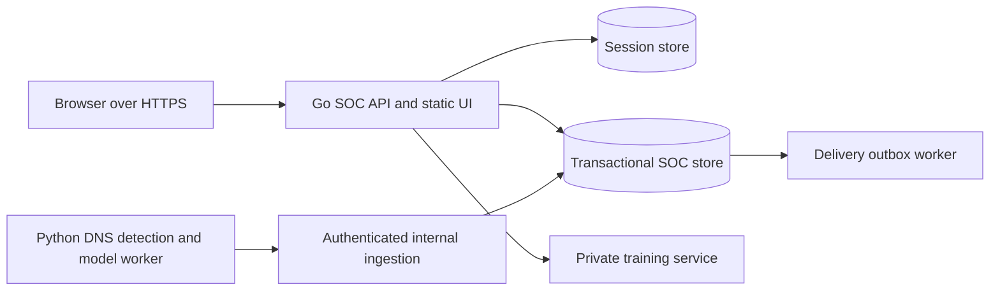

# Go and Rust research for the defensive SOC backend

**Research date:** 2026-11-25  
**Status:** Go compatibility gateway implemented and tested locally on 2026-11-25; transactional Go API migration remains planned.  
**Scope:** routing, API contracts, authentication, SOC workflow writes, storage, and measurable performance for the current dashboard. This extends [AUDIT_FINDINGS.md](AUDIT_FINDINGS.md), [WEB_INTERFACE_PLAN.md](WEB_INTERFACE_PLAN.md), and the [implementation blueprint](Results/IMPLEMENTATION_BLUEPRINT.md).

## Recommendation

Choose **Go with the standard `net/http` ServeMux** for the first SOC API implementation. Go 1.22 added method-specific patterns and path variables, enough for this project's routes without a router dependency. Use Rust with **Axum + Tokio + tower-http** if a later component has a strict memory-safety, no-GC, or low-level parsing requirement that justifies a second runtime. This is an architectural inference for this repository, **not** a benchmark result or a claim that Go is inherently faster than Rust or Python. [Go routing](https://go.dev/blog/routing-enhancements), [Axum routing](https://docs.rs/axum/latest/axum/struct.Router.html), [Rust ownership](https://doc.rust-lang.org/stable/book/ch04-01-what-is-ownership.html).

| Decision | Go first | Rust alternative |
|---|---|---|
| HTTP router | `http.ServeMux`: `GET /api/events/{fp}`, `POST /api/alerts/{fp}/{action}`; explicit method matching and `PathValue`. | Axum `Router`, extractors, shared `State`, Tower middleware. |
| Request defense | `http.Server` header/read/write timeouts, `MaxHeaderBytes`, `http.MaxBytesReader`, context deadlines. | Axum body limits plus `tower-http` request-body limit; Tokio timeouts and cancellation. |
| Concurrency checks | `go test -race`, fuzz decoders, `govulncheck`, `go vet`. | Ownership and type checks, dependency review, async timeout and cancellation tests. |
| Project fit | Fewer new packages for the first migration; easy to place in front of the existing Python detection worker. | Stronger compile-time ownership control, but more framework and async integration work for the same SOC HTTP contract. |

The Go and Rust framework features above come from the [Go standard router](https://go.dev/blog/routing-enhancements), [`net/http.Server`](https://pkg.go.dev/net/http#Server), [Go security guidance](https://go.dev/doc/security/best-practices), [Axum router](https://docs.rs/axum/latest/axum/struct.Router.html), [Axum body limits](https://docs.rs/axum/latest/axum/extract/struct.DefaultBodyLimit.html), [tower-http request limits](https://docs.rs/tower-http/latest/tower_http/limit/struct.RequestBodyLimitLayer.html), and [Tokio timeout](https://docs.rs/tokio/latest/tokio/time/fn.timeout.html). Pin and review actual dependency versions at implementation time.

## Implemented compatibility stage

`dashboard/go-gateway/` now contains a standard-library Go reverse proxy with analyst access-token sign-in, opaque server-side sessions, `HttpOnly` cookies, origin and Host checks, request body caps, and forced actor attribution for JSON writes and actor-scoped reads. Python remains the API implementation and detection engine. When `SOC_INTERNAL_TOKEN` is set on both services, Python rejects direct calls without the gateway's shared secret. This was tested on isolated loopback ports 9100/9101: direct Python `/api/state` returned 403; authenticated gateway `/triage`, `/alerts`, `/events`, `/api/state`, and `/api/analysts` returned 200. The gateway test suite and race detector pass. See [gateway README](../../dashboard/go-gateway/README.md) and [implementation report](Results/GO_GATEWAY_IMPLEMENTATION_REPORT_2026-11-25.md).

This stage preserves existing Python route behavior. It does **not** provide transactional SOC writes, durable sessions, per-route Go authorization, idempotency, or a measured performance gain. Those remain the migration work below. The local demo is now active with Go on port 9000 and guarded Python on port 9002; the gateway remains an optional deployment pattern for other environments.

## Source-grounded starting point

`dashboard/server.py` currently serves pages, static assets, and APIs from one `ThreadingHTTPServer`. `GET /api/state` has an ETag; `GET /api/alerts` is capped at a 150-record feed; `GET /api/events` filters detection alerts rather than raw DNS events. The JSON `Store` uses per-file atomic replacement but the case, alert, and audit data live in different files. A case decision spanning those files is not a database transaction. The server enforces a nonce-based CSP and limits POST JSON to 64 KiB, but `_actor` accepts a known ID from the request body and `authorize` derives tier from that selection. `/api/analysts` reports `authenticated: false`. These are the conditions the new backend must change, not simply reproduce. See [A1, A10, A11, A15, A16](AUDIT_FINDINGS.md).

## Target boundary

The Go process owns browser sessions, authorization, page delivery, SOC reads and writes, and audit attribution. The Python process remains the DNS parsing, scoring, model, and training worker. Do not expose the old Python SOC HTTP port to users after cutover: otherwise callers can bypass Go and still submit a chosen `actor`. A temporary internal proxy is suitable for **read-only** compatibility while writes are ported; `httputil.ReverseProxy.Rewrite` is the Go standard mechanism for rewriting outbound requests and handling forwarding headers. Avoid proxying protected writes as the final design. [Go reverse proxy](https://pkg.go.dev/net/http/httputil#ReverseProxy).

Proposed Go module layout: `cmd/soc-api/main.go` (configuration and server), `internal/httpapi/routes.go` (method-specific registration), `internal/httpapi/middleware.go` (request ID, limits, session, CSRF, authorization), `internal/httpapi/handlers/` (route DTOs and handlers), `internal/soc/` (case and alert state policy), `internal/store/` (transactions and migrations), `internal/worker/` (outbox), and `api/openapi.yaml` (contract). Register exact patterns such as `GET /api/state`, `GET /api/events/{fp}`, and `POST /api/alerts/{fp}/{action}`. Go's `GET` pattern also matches `HEAD`, so test that response path and explicitly deny unexpected methods. Keep `ReadHeaderTimeout`, `ReadTimeout`, `WriteTimeout`, `IdleTimeout`, and `MaxHeaderBytes` configured on the `http.Server` rather than using an unbounded default server.

## Route and contract migration

| Current routes | First Go owner | Contract and policy |
|---|---|---|
| `/soc`, `/triage`, `/alerts`, `/events`, `/static/*` | UI server | Preserve paths and per-response CSP nonce; same-origin assets only. |
| `GET /api/state`, `/api/alerts`, `/api/events`, `/api/health`, `/api/model` | Read API | Preserve fields used by the UI, ETag/304 semantics, demo/real mode, bounded-feed labels, and query limits. Require a session for real SOC data. |
| `GET /api/triage/queue`, `/api/triage/case/{key}`, `/api/analysts`, `/api/audit` | Read API | Resolve “mine” from session identity, not `actor` query input. Limit pagination and audit visibility by permission. |
| `POST /api/alerts/{fp}/{action}`, `/api/alerts/bulk`, `/api/triage/case/{key}/{action}`, `/api/triage/requests/{id}/{decision}` | Workflow API | Derive principal from session. Validate state, checklist, verdict, and independent approver in one transaction; use an idempotency key for retries. |
| `POST /api/run`, `/api/incidents`, `/api/incidents/{id}/action`, `/api/suppressions`, `/api/usecases/preferences` | Privileged API | Explicit permission per route and resource. Preserve `SIMULATED`/`NOT_CONFIGURED` response-action labels until a receiver confirms execution. |
| `/training/api/*` | Separate model-admin boundary | Restrict to authenticated model administrators; private upstream, no browser-held admin token. Do not equate SOC Tier 2 with model-admin permission. |

Define a versioned OpenAPI contract for each route before replacement. Keep field names and status codes where the current UI depends on them. Use a single error envelope `{ "error": { "code": "invalid_input", "message": "…", "request_id": "…" } }` for **new** endpoints; adapt legacy routes until their frontend callers migrate. Explicitly separate `events` (current detection-alert view) from a later raw DNS event store. Do not call a new endpoint durable search until retention and pagination exist.

## Defensive request path

1. **Transport:** terminate HTTPS at a trusted boundary; accept only configured hosts and origins. Keep CSP, no-sniff, frame protection and referrer policy. Do not expose profiling or debug endpoints publicly.
2. **Session:** integrate a chosen identity provider, then issue an opaque, server-stored session ID. Use `__Host-` cookie attributes `Secure; HttpOnly; SameSite=Strict; Path=/` where deployment flow permits. Rotate on login/privilege change; expire and revoke server-side. An HTTP localhost demo can remain read-only without pretending it has production authentication. [OWASP session guidance](https://cheatsheetseries.owasp.org/cheatsheets/Session_Management_Cheat_Sheet.html).
3. **Authorization:** resolve immutable principal ID and explicit permissions from server-owned records. Deny by default on every route and object. Ignore client `actor` for authorization and audit attribution. Keep distinct requester and approver IDs for four-eyes closure. [OWASP authorization guidance](https://cheatsheetseries.owasp.org/cheatsheets/Authorization_Cheat_Sheet.html).
4. **CSRF:** retain same-origin checks and the custom request header; add a session-bound CSRF defense for cookie-authenticated writes. Treat SameSite as defense in depth. [OWASP CSRF guidance](https://cheatsheetseries.owasp.org/cheatsheets/Cross-Site_Request_Forgery_Prevention_Cheat_Sheet.html).
5. **Validation:** exact method and path allowlist; strict JSON decoding that rejects unknown fields for write DTOs; type, length, enum, and range checks; 64 KiB default body limit (route-specific exceptions only); bounded query parameters and response sizes. Return stable 400/401/403/404/409/413/422/429/503 results without stack traces. [OWASP REST guidance](https://cheatsheetseries.owasp.org/cheatsheets/REST_Security_Cheat_Sheet.html).
6. **Concurrency:** every write has a deadline and request ID. A retry with the same `Idempotency-Key`, principal, route and body hash returns the recorded outcome; a changed body returns 409. Bulk writes preflight and commit together. Audit record and outbound delivery intent commit with the decision.

## Persistence and workflow policy

Use a transactional store for authenticated multi-user operation. Suggested tables: `principals`, `sessions`, `detections`, `alerts`, `cases`, `case_alerts`, `close_requests`, `audit_events`, `idempotency_keys`, and `delivery_outbox`. PostgreSQL is the proposed multi-process store; a single-node SQLite prototype is possible, but should not be presented as distributed resilience. Migrate the existing JSON records with a versioned, repeatable import that preserves original IDs, timestamps, source references and a backup. Reconcile record counts and hashes before routing writes to Go.

For close/approval: begin a transaction; lock the case and affected alerts; validate actor permission and current state; verify the required checklist and verdict; if High/Critical false positive, require a pending request approved by a **different** authenticated Tier 2 principal; apply all changes; append audit and outbox rows; commit. On conflict, roll back and return 409 with the current version. Define the `Resolved` verdict rule explicitly before porting, since current `require_verdict` defaults to false. Go's `sql.Tx` supports commit/rollback as a unit. [Go transactions](https://go.dev/doc/database/execute-transactions).

## Performance and delivery gates

“Faster” must be measured against the Python baseline using the **same** response payloads and demo/real input sizes. Record p50/p95/p99 latency, requests per second, CPU, RSS, allocation rate, error rate, and database time for `/api/state`, queue, events pagination, and one representative write. Target no regression on correctness and set latency/throughput targets from the measured baseline; do not substitute a language benchmark for this workload. Profile only in a protected environment. [Go diagnostics](https://go.dev/doc/diagnostics).

Small **demo-only, loopback, serial** baseline on 2026-11-25 (15 GETs per route, no concurrency; observed max used as nearest-rank p95):

| Route | p50 | observed max / p95 | Last response size |
|---|---:|---:|---:|
| `/api/state` | 3.22 ms | 7.81 ms | 135,670 B |
| `/api/events?limit=50` | 1.54 ms | 1.64 ms | 40,895 B |
| `/api/triage/queue?limit=50&group=source` | 2.13 ms | 14.78 ms | 12,911 B |

These figures are a smoke baseline for this process on this machine, not a load test or production target. A meaningful speed comparison needs a fixed input snapshot, concurrency levels, warm/cold runs, and the same endpoint semantics after migration.

Build order:

1. Freeze request/response fixtures and route authorization matrix; add tests for malformed input, HEAD/405, ETag/304, pagination bounds, CSP, and browser compatibility.
2. Implement Go server shell with method-specific `ServeMux`, timeouts, logging with redaction, request IDs, health/readiness, and read-only demo routes. Keep Python as worker.
3. Implement production identity/session and authorization; replace browser-selected actor semantics. Verify spoofed body/query/header identities are ignored, missing sessions fail, and Tier 1/Tier 2 separation holds.
4. Add transactional store, import tool, and workflow write routes. Test duplicate submissions, concurrent approvals, all-or-nothing bulk, restart recovery, and audit/outbox consistency.
5. Cut over reads and writes behind the existing UI; compare JSON fixtures and performance; disable direct Python SOC HTTP access; run a real-mode Technitium walkthrough.

Release gate for the complete Go API: `go test ./...`, `go test -race ./...`, `go vet ./...`, fuzz parsers and DTOs, `govulncheck`, route contract tests, browser checks on all SOC views, and a load test against representative data. Demonstrate that an unauthenticated client and a Tier 1 client cannot claim a Tier 2 identity through **any** route. The compatibility gateway meets the Go test/race/vet gates; the remaining release gates have not been completed.
